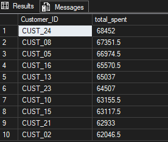
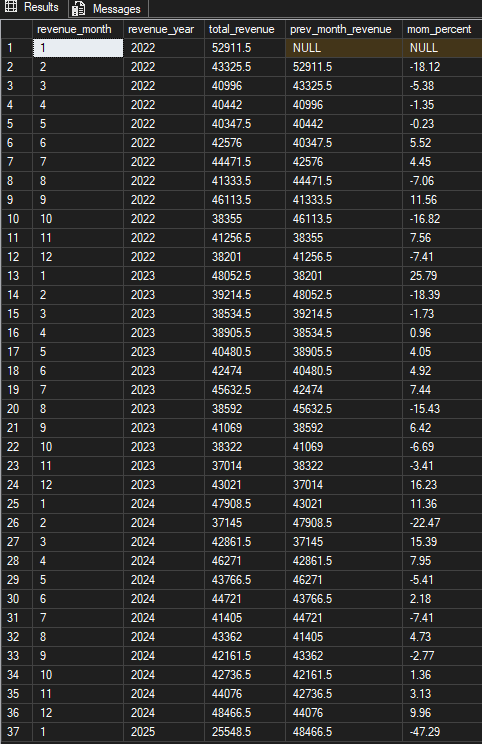
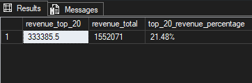

# Retail Sales SQL Analysis

An end-to-end SQL project demonstrating data cleaning, validation, exploratory data analysis, and business-focused analysis using Microsoft SQL Server.

## 📌 Project Overview

This project explores retail transaction data to transform raw sales records into meaningful business insights. It covers data quality checks, missing-value handling, revenue analysis, product performance, customer spending patterns, and month-over-month revenue trends.

The project demonstrates how SQL can be used to prepare data for analysis and answer practical business questions.

### Project Highlights

- Data profiling, cleaning, and validation
- Missing-value investigation and recovery of derivable values
- Duplicate transaction ID checks
- Revenue and product performance analysis
- Customer spending and revenue concentration analysis
- Advanced SQL using CTEs and window functions
- Data integrity checks and schema documentation

---

## 📊 Dataset

The dataset contains **12,575 retail transaction records** with information about customers, products, payments, and sales.

### Key Columns

| Column | Description |
|---|---|
| `Transaction_ID` | Identifier for a transaction |
| `Customer_ID` | Identifier for the customer |
| `Category` | Product category |
| `Item` | Product or item name |
| `Price_per_unit` | Price per unit |
| `Quantity` | Quantity purchased |
| `Total_spent` | Total recorded transaction spending |
| `Payment_method` | Payment method used |
| `Location` | Store or transaction location |
| `Transaction_date` | Date of the transaction |
| `Discount_applied` | Indicates discount status, where recorded |

**Note:** The dataset is analyzed at the transaction-record level. The meaning of `Total_spent` and its relationship to discounts should be interpreted according to the dataset's definitions.

---

## 🛠️ Tools and Technologies

- **Database:** Microsoft SQL Server
- **SQL Environment:** SQL Server Management Studio (SSMS)
- **Version Control:** Git and GitHub
- **Documentation:** Markdown and Mermaid diagrams

---

## 📁 Project Structure

```text
Retail_sql_analysis/
├── data/
│   └── retail_store_sales.csv
├── images/
│   ├── top_10_customers.png
│   ├── monthly_revenue.png
│   └── pareto_analysis.png
├── sql/
│   ├── 01_data_cleaning.sql
│   └── 02_business_analysis.sql
├── .gitignore
├── LICENSE
└── README.md
```

---

## 🧹 Data Cleaning and Validation

The original data is preserved in a raw table, while a separate cleaned table is created for analysis.

### Cleaning Workflow

1. **Data profiling:** Inspected the table structure, row counts, categorical values, and numerical fields.
2. **Missing-value analysis:** Identified NULL values in important columns and evaluated whether missing values could be recovered.
3. **Value recovery:** Where the necessary inputs were available, missing values could be derived from related columns.
4. **Duplicate checks:** Checked transaction IDs for repeated values.
5. **Numerical validation:** Compared recorded totals with the product of unit price and quantity for eligible records.
6. **Data types and integrity:** Reviewed appropriate data types and potential constraints for transaction IDs and numerical fields.
7. **Cleaned table creation:** Created a separate `cleaned_retail_stores_sales` table for downstream analysis.

### Missing-Value Handling Decisions

Missing values should not be replaced with arbitrary defaults.

Where the required inputs are available:

- Missing `Price_per_unit` can be derived as `Total_spent / Quantity`.
- Missing `Quantity` can be derived as `Total_spent / Price_per_unit`.
- Division-by-zero errors can be avoided using `NULLIF()`.

If a value cannot be reliably recovered, it should remain NULL until there is sufficient information to determine its correct value.

A missing `Discount_applied` value should not automatically be treated as `FALSE`, because missing information does not necessarily mean that no discount was applied.

### Validation Results

The validation compared `Price_per_unit * Quantity` against `Total_spent` for records with valid values. The checks found no mismatches among the eligible records.

The raw table remains available as a reference for comparing the original and cleaned data.

> **Data quality note:** Duplicate transaction IDs are checked for potential duplicates. A duplicate check does not automatically mean that duplicate records have been removed.

---

## 💡 Business Analysis

The business analysis script addresses questions across revenue, products, store operations, and customer behavior.

### 🪙 Revenue and High-Level Metrics

- What is the total recorded revenue?
- How many transactions are recorded?
- What is the total quantity sold?
- What is the average transaction value?
- How does revenue change month over month?

### 📦 Product Performance

- Which product category generates the highest revenue?
- Which 10 items generate the most revenue?
- Which category has the highest quantity sold?
- Which category and location combination generates the highest revenue?

### 🏪 Store Operations and Payments

- How does revenue compare across locations?
- Which payment method is used most frequently?
- How does average transaction value differ between discounted and non-discounted transactions?

### 👥 Customer Analysis

- Who are the top 10 customers by total spending?
- What is the average number of transactions per customer?
- What is the average spending per customer?
- What percentage of total revenue is generated by the top 20% of customers?

**Terminology note:** The category-location analysis identifies the combination with the highest revenue, not necessarily the highest profit. Profitability requires cost or margin data.

---

## 📈 Project Results

The following screenshots showcase selected outputs from the SQL analysis. They make it easier to review the results without running the queries.

### 1. Top 10 Customers by Total Spending

Ranks customers according to their total recorded spending, highlighting the customers with the highest cumulative spending in the dataset.



### 2. Monthly Revenue Analysis

Shows monthly revenue and month-over-month changes, helping identify changes in recorded sales over time.



### 3. Pareto Analysis — Customer Revenue Contribution

Measures the percentage of total revenue generated by the highest-spending 20% of customers. This helps assess how concentrated revenue is among the top customers.



---

## 🧠 SQL Concepts Demonstrated

### Core SQL

- `SELECT`, `WHERE`, `ORDER BY`
- `GROUP BY`
- Aggregate functions: `SUM()`, `AVG()`, `COUNT()`
- Conditional logic using `CASE`
- NULL handling using `NULLIF()`

### Intermediate and Advanced SQL

- Common Table Expressions (CTEs)
- Window functions using `LAG()` and `ROW_NUMBER()`
- Multi-level aggregation
- Ranking and customer revenue concentration analysis
- Month-over-month calculations
- Data type selection and integrity constraints

---

## 💡 SQL Design Decisions

### Why use `LAG()` for month-over-month analysis?

`LAG()` retrieves the previous month's revenue within an ordered result set. It avoids the need for a self-join and provides a readable way to compare revenue across consecutive months.

The ordering uses both year and month to keep the chronology correct when the dataset spans multiple years.

### Why compare discounted and non-discounted transactions?

Grouping transactions by `Discount_applied` allows the average transaction values of the two groups to be compared. Both groups are retained rather than assuming one group should be excluded.

This is a descriptive comparison. It does not prove that discounts caused any observed difference in spending.

### Why preserve the raw table?

Keeping the raw table unchanged makes it possible to compare the original data with the cleaned version, validate transformations, and investigate unexpected results.

### Why use window functions for customer ranking?

`ROW_NUMBER()` ranks customers by spending and supports the identification of the highest-spending customer segment. Aggregation and window functions can then be used to calculate that segment's contribution to total revenue.

---

## 🗂️ Database Schema

The project uses a single transaction-level table named `cleaned_retail_stores_sales` containing customer, product, pricing, payment, location, date, and discount information.

Each row represents a retail transaction.

| Column Name | Description | Data Type |
|---|---|---|
| `Transaction_ID` | Unique transaction identifier, subject to validation | INT |
| `Customer_ID` | Customer identifier | VARCHAR |
| `Category` | Product category | VARCHAR |
| `Item` | Product or item name | VARCHAR |
| `Price_per_unit` | Price per unit | DECIMAL |
| `Quantity` | Quantity purchased | INT |
| `Total_spent` | Total recorded transaction spending | DECIMAL |
| `Payment_method` | Payment method used | VARCHAR |
| `Location` | Store or transaction location | VARCHAR |
| `Transaction_date` | Transaction date | DATE or DATETIME |
| `Discount_applied` | Discount status | BIT or VARCHAR |

### Schema Notes

- `Transaction_ID` is intended to uniquely identify a transaction, subject to validation of uniqueness and non-NULL values.
- `Customer_ID` identifies the associated customer.
- `Price_per_unit`, `Quantity`, and `Total_spent` support sales calculations.
- `Transaction_date` supports time-based analysis.
- `Discount_applied` supports comparisons by discount status.

The diagram represents the logical structure of the dataset. The actual SQL Server data types and constraints should be confirmed against the table definition.

---

## 🔄 Project Workflow

```text
Raw Retail Data
      |
      v
Data Profiling
      |
      v
Data Cleaning
      |
      v
Data Validation
      |
      v
Cleaned Transaction Table
      |
      v
Business Analysis
      |
      v
Results and Business Insights
```

---

## 🏁 Conclusion

This project demonstrates how Microsoft SQL Server can be used to transform raw retail transaction data into a structured dataset for business analysis.

It combines data cleaning and validation with revenue analysis, product performance analysis, customer spending analysis, and time-based comparisons. It also demonstrates the use of CTEs, window functions, and multi-level aggregations to solve practical analytical questions.

The project provides a foundation for further work, such as dashboard development, customer segmentation, and analysis using additional cost or profit data.

---

## 📄 License

This project is licensed under the MIT License. See the [`LICENSE`](LICENSE) file for details.

The dataset may be subject to separate licensing or usage restrictions.
